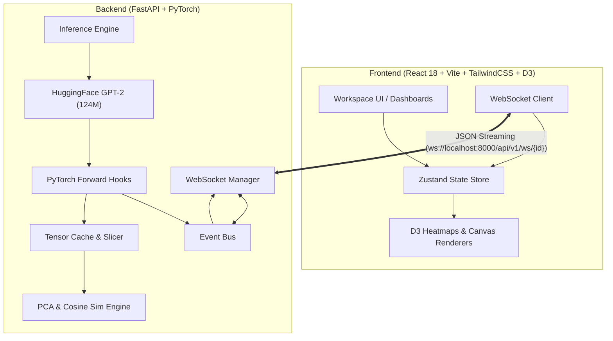

<div align="center">

# 🧠 NeuralScope
### *Interactive Mechanistic Interpretability & Real-Time LLM Inference Explorer*

[](https://opensource.org/licenses/MIT)
[](https://www.python.org/)
[](https://pytorch.org/)
[](https://fastapi.tiangolo.com/)
[](https://react.dev/)
[](https://www.typescriptlang.org/)
[](https://vitejs.dev/)
[](https://tailwindcss.com/)

<p align="center">
  <b>Observe the internal computational journey of Large Language Models in real-time.</b><br>
  NeuralScope exposes every layer, tensor activation, attention head, and sampling logit — backed by real PyTorch tensor compute, not synthetic simulations.
</p>

[Key Features](#-key-features) • [Architecture](#-architecture) • [Quick Start](#-quick-start) • [Visualizations](#-deep-dive-into-visualizations) • [API & Protocol](#-websocket-event-protocol) • [Roadmap](#-roadmap)

---

</div>

## 🌟 Overview

Modern Large Language Models are frequently treated as black boxes: tokens enter, magic occurs across billions of parameters, and tokens emerge. **NeuralScope dismantles the black box.**

Built from scratch with **PyTorch forward hooks**, **FastAPI**, **WebSockets**, and a modern **React + D3.js** interface, NeuralScope instruments the transformer inference loop at native speed. Every token generated by the model broadcasts its exact internal states across a structured event bus to your browser.

> **Data Provenance Guarantee:** Every float displayed in NeuralScope originates directly from actual model execution in PyTorch tensors.

---

## ✨ Key Features

- **🔴 Live Autoregressive Decoding Stream**: Real-time token streaming with throughput (tok/s), latency, duration, and time-to-first-token telemetry.
- **🔤 Byte-Pair Encoding (BPE) Inspector**: Granular subword segmentation, token IDs, vocabulary positioning, and Unicode byte sequence validation.
- **🌐 12-Head Attention Visualizer**: High-resolution interactive heatmaps for all 12 self-attention heads simultaneously or zoomed individually, plus aggregate mean attention.
- **🧭 Embedding Space & Semantic Geometry**: Real-time 2D PCA projection of token representations, pairwise cosine similarity matrix, and ranked semantic proximity pairs.
- **🎛️ Universal Tensor Slicer**: Multi-dimensional tensor inspector with slice selectors (`[batch, head, seq_q, seq_k]`), interactive cell grid pagination, and dynamic distribution histograms.
- **📐 Mathematical Operation Deconstructor**: In-depth theoretical and live breakdown of LayerNorm ($\mu, \sigma^2$), Scaled Dot-Product Attention ($\text{Softmax}(\frac{QK^T}{\sqrt{d_k}})V$), MLP expansion ($768 \to 3072 \to 768$ with GELU), and Residual streams.
- **📊 Sampling Dynamics & Logit Distribution**: Interactive temperature, Top-K, and Top-P (Nucleus) controls with live bar charts of candidate token probabilities.

---

## 🏛 Architecture



### Dataflow Pipeline
1. **Prompt Ingestion**: Prompt and sampling hyperparameters (`temperature`, `top_k`, `top_p`) arrive via REST/WebSocket.
2. **Hook Instrumentation**: PyTorch forward hooks are attached to embedding layers, 12 transformer blocks (`attn.c_attn`, `attn.c_proj`, `ln_1`, `ln_2`, `mlp.c_fc`, `mlp.c_proj`), and the LM head.
3. **Incremental Stepping**: For each autoregressive generation step, hooked activations are captured, serialized, and pushed asynchronously through the event bus.
4. **Reactive Rendering**: The frontend Zustand store ingests events in real-time, updating timeline sequences, attention heatmaps, and generation buffers with sub-frame rendering latency.

---

## 🚀 Quick Start

### Prerequisites
- **Python**: 3.10, 3.11, or 3.12
- **Node.js**: v18+ and npm v9+
- **OS**: Windows, macOS, or Linux

---

### Option A: One-Click Startup (Windows)

Clone the repository and run the convenience launchers:

```powershell
# 1. Clone repository
git clone https://github.com/anand7771-dev/NeuralScope.git
cd NeuralScope

# 2. Run automated installer (installs PyTorch, packages, and npm modules)
powershell -ExecutionPolicy Bypass -File scripts\install.ps1

# 3. Launch both backend and frontend servers
.\start-all.bat
```

---

### Option B: Manual Setup

#### 1. Backend Setup
```bash
cd backend

# Create virtual environment (optional but recommended)
python -m venv venv
# Windows: venv\Scripts\activate | Unix: source venv/bin/activate

# Install PyTorch (CPU or CUDA)
pip install torch --index-url https://download.pytorch.org/whl/cpu

# Install dependencies
pip install -r requirements.txt

# Start backend server
python -m uvicorn app.main:app --host 0.0.0.0 --port 8000 --reload
```
*Backend API will run at `http://localhost:8000` (Swagger Docs at `http://localhost:8000/docs`).*

#### 2. Frontend Setup
```bash
cd frontend

# Install dependencies
npm install

# Start Vite development server
npm run dev
```
*Frontend interface will open at `http://localhost:5173`.*

---

## 🔬 Deep Dive into Visualizations

### 1. Decoding Stream (`GenerationView`)
- Real-time token streaming visualization
- Step-by-step token metrics: throughput (tokens/sec), first-token latency, and total forward compute duration.
- Detailed step timeline logging each phase of computation.

### 2. Multi-Head Attention (`AttentionExplorer`)
- Side-by-side comparative inspection of all **12 self-attention heads**.
- Interactive D3 heatmaps displaying source-to-target token attention weights.
- Single-head zoom mode with precise floating-point values on hover.
- Aggregated Mean Head to observe global information flow across layers.

### 3. Embedding Geometry (`EmbeddingExplorer`)
- **2D PCA Projection**: High-dimensional (768-D) token representations projected onto principal components with variance explained metrics.
- **Cosine Similarity Heatmap**: Pairwise $\cos(\theta) = \frac{\mathbf{u} \cdot \mathbf{v}}{\|\mathbf{u}\|_2 \|\mathbf{v}\|_2}$ matrix displaying semantic proximity.
- **Ranked Semantic Proximity**: Instant identification of most semantically aligned token pairs in the prompt.

### 4. Universal Tensor Inspector (`TensorInspector`)
- Direct access to intermediate activations stored in memory.
- N-dimensional slice navigation with coordinate controls.
- Interactive 2D matrix view with color-scaled cells.
- Dynamic histogram showing distribution, mean ($\mu$), standard deviation ($\sigma$), min, and max values.

### 5. Mathematical Operations (`OperationInspector`)
- Live parameter values overlaid on standard transformer formulas:
  - **LayerNorm**: $y = \frac{x - \mathrm{E}[x]}{\sqrt{\mathrm{Var}[x] + \epsilon}} \odot \gamma + \beta$
  - **Scaled Dot-Product Attention**: $\mathrm{Attention}(Q, K, V) = \mathrm{softmax}\left(\frac{QK^T}{\sqrt{d_k}}\right)V$
  - **MLP Block**: $\mathrm{GELU}(xW_1 + b_1)W_2 + b_2$
  - **Residual Connection**: $x_{l+1} = x_l + \mathrm{SubLayer}(x_l)$

---

## 📡 WebSocket Event Protocol

NeuralScope uses a high-performance typed event stream over WebSockets:

| Event Type | Direction | Payload Description |
|------------|-----------|---------------------|
| `session_started` | S → C | Session metadata, model config, prompt info |
| `tokenization_completed` | S → C | Token IDs, string tokens, vocabulary coordinates |
| `inference_started` | S → C | Timestamp, step sequence setup |
| `layer_started` | S → C | Layer index, sublayer identifier |
| `layer_completed` | S → C | Sublayer activations summary, execution time |
| `logits_generated` | S → C | Unnormalized output logit vector summary |
| `probabilities_calculated`| S → C | Post-softmax probabilities, Top-K/Top-P candidates |
| `token_selected` | S → C | Selected token ID, token text, log-probability |
| `token_generated` | S → C | Incremental text append, cumulative throughput |
| `inference_completed` | S → C | Total tokens, full execution metrics |

---

## 📁 Repository Structure

```text
NeuralScope/
├── backend/
│   ├── app/
│   │   ├── adapters/          # Model adapters (GPT-2, expandable to LLaMA)
│   │   ├── api/               # FastAPI REST routes & WebSocket endpoints
│   │   ├── core/              # Event bus, session management, tensor cache
│   │   ├── inference/         # Generation engine & forward pass runner
│   │   ├── instrumentation/   # PyTorch hooks & execution profilers
│   │   ├── tokenization/      # BPE tokenization service
│   │   └── utils/             # Dimensionality reduction (PCA) & math helpers
│   ├── requirements.txt       # Python dependencies
│   └── run.py                 # Backend launch entrypoint
├── frontend/
│   ├── src/
│   │   ├── app/               # Main layout, router & navigation
│   │   ├── components/        # Reusable UI widgets & D3 charts
│   │   ├── features/          # Tab views (Attention, Embeddings, Tensors, etc.)
│   │   ├── hooks/             # WebSocket and inference hooks
│   │   ├── services/          # HTTP API & WebSocket client
│   │   └── stores/            # Zustand reactive state stores
│   ├── package.json           # Frontend dependencies & scripts
│   └── vite.config.ts         # Vite build & reverse proxy configuration
├── docs/                      # Architectural specs & event schemas
├── scripts/                   # Automated Windows/Linux installation scripts
├── start-all.bat              # One-click startup script
└── README.md                  # Project documentation
```

---

## 🗺 Roadmap

- [x] **Phase 1: Real-time Streaming Core** — PyTorch GPT-2 adapter, WebSocket engine, live autoregressive decoding.
- [x] **Phase 2: Full Observability Suite** — 12-head attention heatmaps, 2D PCA embedding explorer, universal tensor slicer, mathematical deconstructors.
- [ ] **Phase 3: Interactive Stepping & Interventions** — Play, pause, step-forward, step-backward, and runtime attention head ablation/masking.
- [ ] **Phase 4: KV-Cache Dynamics** — Visual representation of key-value cache memory growth, prefill vs. decode phase profiling.
- [ ] **Phase 5: Modern Architecture Expansion** — Support for LLaMA-3, Mistral, and Gemma models featuring RoPE (Rotary Positional Embeddings), RMSNorm, and SwiGLU activations.

---

## 🤝 Contributing

Contributions, issues, and feature requests are welcome!

1. Fork the repository
2. Create your feature branch (`git checkout -b feature/amazing-feature`)
3. Commit your changes (`git commit -m 'Add some amazing feature'`)
4. Push to the branch (`git push origin feature/amazing-feature`)
5. Open a Pull Request

---

## 📄 License

Distributed under the **MIT License**. See [`LICENSE`](LICENSE) for more information.

<div align="center">
  <sub>Built with ❤️ for AI researchers, engineers, and students passionate about understanding deep learning from the inside out.</sub>
</div>
